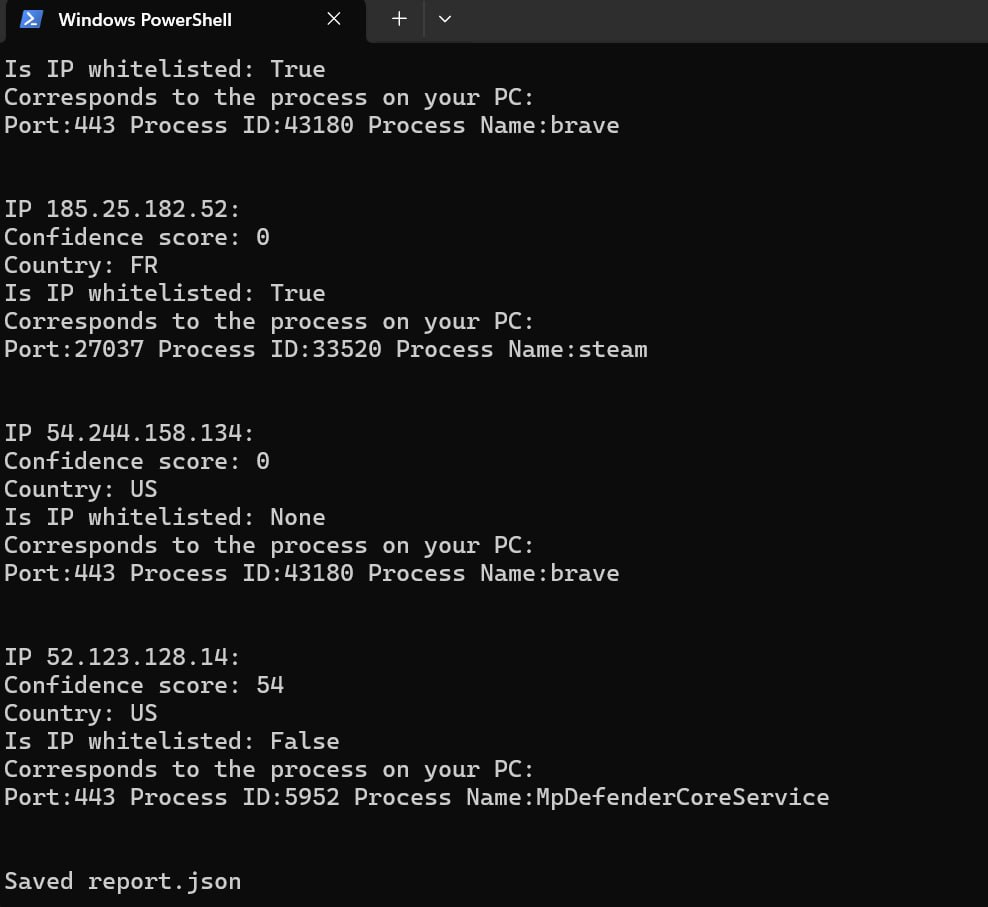

# BeSecure: Network Connection Threat Enrichment

**Pair project (my part: the Python analyser)** · Advanced Scripting for Cyber Security (COMP H2702) · BSc Applied Cybersecurity & Digital Forensics, TU Dublin · Dec 2025

BeSecure shows which processes on a Windows machine are talking to which internet hosts, and whether those hosts have a bad reputation. PowerShell collects the live TCP connections and the processes that own them. Python then checks each public IP against the AbuseIPDB threat-intelligence API and produces a report.

## Why it's useful

Task Manager shows running processes, but not who they are talking to. A process called `svchost.exe` is normal. The same process talking to a known botnet IP is a strong indicator of compromise.

BeSecure gives an analyst that answer in one command, which supports the **Detect** function of the NIST Cybersecurity Framework.

Example: a user says their PC is slow. The analyst runs `besecure.ps1` and sees `powershell.exe` connected to an IP with a 100% abuse confidence score. That machine gets isolated and the process investigated.

## Team and my contribution

| Part | Owner |
|---|---|
| **`besecure.py`: Python analysis and AbuseIPDB integration** | **Mykyta Doroshenko (me)** |
| `getconnections.ps1` and `besecure.ps1`: PowerShell collection and orchestration | Vladyslav Shkurina |

What I built in `besecure.py`:

- **AbuseIPDB API integration** with `requests`. For each public IP, it gets the abuse confidence score, country and whitelist status.
- **Secure key handling.** The API key is read from an environment variable, never hard-coded.
- **A regex filter** that drops private (RFC 1918) and loopback addresses before any API call. My first version queried every connection, including local `192.168.x.x` traffic, which was slow and wasted the API quota.
- **Correlation and reporting.** Each IP's threat data is matched back to the local port, PID and process name, printed to the console and saved as `report.json`.
- **Error handling** for a missing or invalid input file and for failed API requests.

**Shared fix:** PowerShell wrote `connections.json` with a byte-order mark, which crashed the Python JSON parser. We found it together in a hex dump and fixed it by reading the file as `utf-8-sig`.

## How it works

```
getconnections.ps1  ->  connections.json  ->  besecure.py  ->  AbuseIPDB API  ->  console + report.json
(PowerShell: Get-NetTCPConnection + Get-Process)   (Python: filter, enrich, correlate)
```

`besecure.ps1` runs both steps in order.

## Demo



*Each public IP with its AbuseIPDB confidence score, country, whitelist status and the local process that owns the connection.*

## Run it

Requirements: Windows PowerShell 5.1+ (or PowerShell 7), Python 3.10+, and a free AbuseIPDB API key.

```powershell
pip install -r requirements.txt
$env:ABUSEIPDB_API_KEY = "<your key>"
.\besecure.ps1
```

You can also run the two steps separately: `.\getconnections.ps1`, then `python .\besecure.py`. Some process names need an elevated (Administrator) PowerShell.

## Tools

Python (`requests`, `re`, `json`), PowerShell (`Get-NetTCPConnection`, `Get-Process`), AbuseIPDB API, JSON
